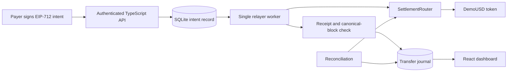
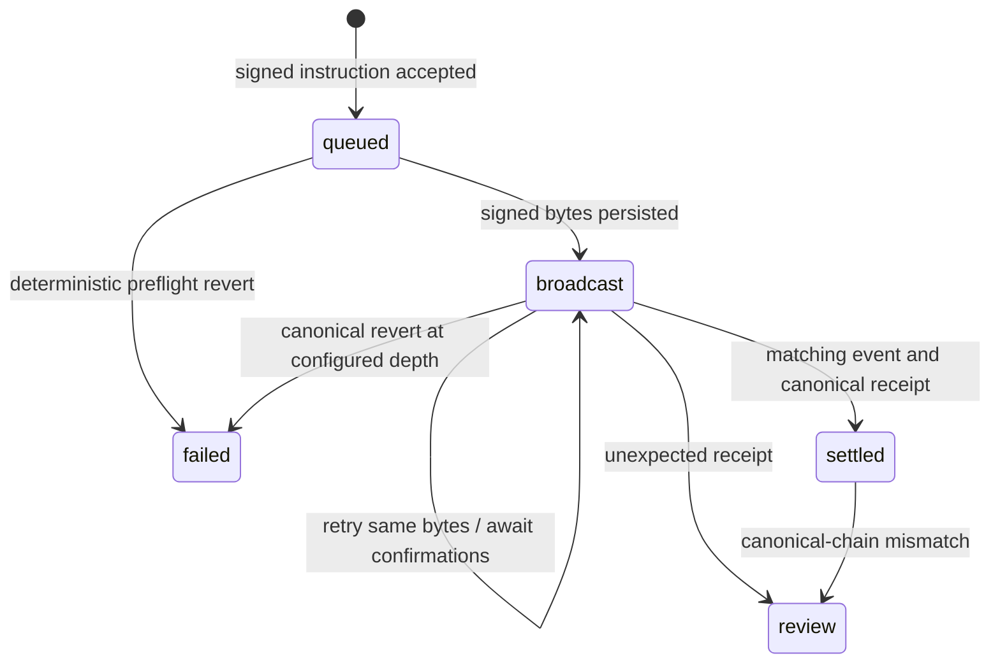

# Architecture

The chain determines token ownership. SQLite is an operational projection, not a separate source of asset balances. A transfer journal row pairs a debit account and credit account with the same positive amount, asset, and transaction provenance. This is a transfer journal rather than a complete general ledger: issuance, fiat deposits, FX valuation, and redemption accounting are outside the implemented model.

## Lifecycle

Signed raw bytes are persisted before sending. After restart, the worker can inspect or retransmit the same transaction hash instead of creating another transfer. Persisted broadcasts are recovered before queued instructions because their signed bytes already reserve a relayer nonce. Within a status group, SQLite insertion order (`rowid`) is used rather than wall-clock timestamps, so clock rollback cannot reorder nonce allocation. An unresolved broadcast blocks subsequent native-nonce allocation.

RPC uncertainty remains pending. A preflight `CALL_EXCEPTION` becomes terminal only when it carries nonempty revert data; missing or empty revert data remains retryable because ethers can use that error code for node or transport failures as well. This is conservative: a genuine empty-data contract revert may need operator investigation.

The worker is serialized within one process. SQLite uses WAL and `synchronous=FULL`; intent/audit, broadcast/audit, failure-status/audit, and journal/finalization/audit writes are transactional. Tests terminate a real worker process at broadcast/finalization boundaries, reopen its file-backed database, and verify recovery without duplicate transfer or journal rows. They also interrupt an uncommitted SQLite transaction and verify rollback. These checks do not establish resilience to arbitrary hardware or filesystem failure.

Store mutations also enforce the lifecycle inside `BEGIN IMMEDIATE`, with an explicit `StateTransitionError` for unknown payments, invalid transitions, or conflicting stored provenance:

| Mutation | Allowed state transition |
| --- | --- |
| Reserve signed broadcast | `queued` → `broadcast` |
| Record failure | `queued` or `broadcast` → `failed` |
| Flag review | `broadcast` or `settled` → `review` |
| Finalize journal | `broadcast` → `settled` |

Repeating an already-broadcast reservation with identical bytes/hash, an identical settled finalization, or an identical terminal status/detail is a no-op with no extra audit entry. Conflicting repetitions and terminal rewrites are rejected. Acceptance's existing-intent lookup now occurs inside the same write transaction as insertion, rather than before it.

Finalization compares every existing journal field against the payment, transaction, and requested block provenance instead of silently ignoring a duplicate insert. A settled retry requires the existing journal and block metadata to agree; a missing or conflicting journal is rejected rather than repaired automatically. These are application invariants over a mutable local database, not tamper-proof storage or on-chain proof. Receipt verification remains the service's responsibility.

There is no distributed lease. Only one process may own a relayer key. A stuck or replaced native transaction may block the queue until an operator investigates it.

## Wallet authorization

The router exposes `isValidPaymentSignature(Payment,bytes)` and reuses it internally in settlement. The API calls that same view before storing either a new authorization or an identical POST replay. EOAs use OpenZeppelin `ECDSA.tryRecover`; deployed wallets receive an ERC-1271 STATICCALL from the router. Successful return data must contain at least 32 bytes whose first complete word exactly equals the padded `0x1626ba7e` magic value. Reverts, short responses, wrong magic, and nonzero padding fail the check.

The address-only helper adapts the attributed OpenZeppelin 5.4 validation pattern for the existing Paris EVM target. Importing that release's full `SignatureChecker` also imports a Cancun-only MCOPY path; the adaptation avoids an unrelated runner/EVM upgrade. Its source is counted with the application, with third-party attribution preserved separately from Besu.

Wallet validity is a point-in-time policy decision, rechecked during dispatch and execution. A queued authorization can be revoked; a signed native transaction can subsequently revert; an already-mined transfer is unaffected. Replaying the same intent never replaces its stored signature. The view does not reserve funds or a nonce, validate overall settlement eligibility, or provide finality. Existing routers must be redeployed with the new ABI/address. Local-EVM wallet tests pass on Windows and in Linux CI; the previous Besu run exercised the EOA path. Trusted-RPC, wallet gas/returndata griefing, and untested wallet-integration limits remain.

The Besu acceptance extension deploys a test-only caller-bound contract wallet after the existing EOA quorum/recovery sequence. It checks one wallet settlement and pre-signing revocation of another authorization, then reconciliation and final node agreement. Shared in-memory fixture compilation passed 22 local-EVM wallet cases and typecheck; the live Besu extension and all 253 regular CI cases now pass. The router/API are unchanged by this tooling increment. The wallet case follows quorum restoration; it does not test wallet transactions through quorum loss or demonstrate a production wallet integration.

## Resource lifecycle and shutdown

The runtime worker schedules one tick at a time and `stop()` awaits the active tick. HTTP draining tracks handler promises rather than socket lifetimes, since an RPC-awaited handler can still write SQLite after its client disconnects. A shared idempotent shutdown starts worker/request/listener drains together and closes shared resources only after those drains finish within the default 20-second cooperative budget. New HTTP requests are rejected with 503/connection close during draining. RPC and demo entrypoints share the guarded SIGINT/SIGTERM path.

Previously, immediate signal cleanup could destroy the provider or close SQLite while an active worker or handler still owned a pending write. The new ordering addresses that race. Failed or timed-out drains never initiate resource closing later; entrypoints report a fixed diagnostic/exit 1 so durable state can be inspected on restart. Successful close allows natural exit 0. The timer cannot preempt synchronous JavaScript, cancel already-started resource closing, or make OS force-kill graceful. Windows tests/typecheck/build passed with the POSIX case explicitly skipped; Linux CI passed all 127 cases, including that real-SIGTERM helper integration. The fixture tests shared helpers with a real signal, not a complete application CLI process; no daemon-soak or production-readiness claim is made.

RPC mode uses an explicit HTTP timeout (five seconds by default, configurable
through `RPC_TIMEOUT_MS`) with one transport attempt. A silent upstream therefore
releases the current HTTP exchange so the worker can retry from durable state on
a later tick. A timeout never proves that a submitted transaction was rejected.

## Authorization and policy

The EIP-712 domain is ClearLedger version 1 with chain ID and verifying contract. Instructions contain payment ID, payer, payee, token, amount, nonce, and deadline. The contract requires valid EOA/ERC-1271 authorization, current payer nonce, unused payer-scoped ID, and an unexpired deadline.

Amounts are integer strings in smallest token units at the API boundary and uint256 on chain. Settlement does not use floating-point arithmetic. The dashboard formats decimals for a descriptor matching the active chain/token and passing its display-field checks; unknown/wrong-chain assets and failed checks retain raw base units and token identity. The frontend rejects unknown fields, checks nonzero 20-byte address syntax, and compares addresses case-insensitively without verifying EIP-55 casing. Startup configuration validates/normalizes checksums. Formatting uses exact BigInt arithmetic rather than converting large amounts to floating point.

An older demo response without `assetMetadata` retains a narrow compatibility fallback for its explicit known six-decimal dUSD token. A present registry, including an empty or invalid one, disables that fallback.

Optional `ASSET_METADATA` is a strict operator registry keyed by chain ID/token, with at most 100 entries, safe positive chain IDs, checksummed nonzero addresses, restricted ASCII symbols, and integer decimals 0–255. Overview exposes active-chain descriptors with configured/demo provenance. Demo mode explicitly adds its known six-decimal dUSD descriptor, rejects a configured collision, and enforces the active-chain limit including that descriptor. The UI shows the registry/source; no metadata RPC lookup, price, or reserve inference is involved. This changes presentation without changing amounts, settlement policy, or existing authentication/pager contexts. Evidence and limitations are recorded in [validation](VALIDATION.md#configured-asset-metadata).

An identical API retry returns its existing record. Different instructions with an existing payer/payment ID produce HTTP 409. Failed instructions remain recorded; a replacement requires a newly authorized ID.

Roles separate issuance, policy, administration, and relaying. The demo assigns administrative roles to one temporary wallet. Router limits are per payer and asset, with UTC days derived from block timestamps. Direct ERC-20 transfers between eligible accounts bypass router spending limits; the limits are not a system-wide compliance guarantee.

Supported assets must be reviewed standard tokens without rebasing or transfer fees. A recipient balance-delta check detects incompatible outcomes but does not make arbitrary malicious tokens safe.

## Finality and projection boundaries

Initial confirmation requires exact receipt status `0` or `1`, a matching transaction hash, safe block metadata/head, canonical block number/hash, and configured confirmation depth before either failed or settled. Inconsistent or malformed RPC evidence remains broadcast for retry with its existing signed bytes and nonce priority. Missing or non-array success logs remain retryable too. Status `1` requires the expected configured-router settlement event to journal; a confirmed valid log array without that event, including an explicit empty array, goes to review. See validation for local and CI evidence. These checks rely on trusted RPC data rather than independent proofs or a finality guarantee.

Reconciliation detects a later mismatch and marks the payment for review; it does not automatically reverse or rebuild journals.

Reconciliation validates stored intent/ID/transaction/block metadata, receipt hash/status/block identity, canonical block number/hash, all journal fields, and the configured router's matching `PaymentSettled` event. Hexadecimal hash comparison ignores letter case. Missing receipt/block data or a mismatch triggers conservative review with the journal retained. RPC exceptions abort without falsely reviewing the affected row; earlier mismatch flags already committed in the scan are not rolled back. See validation for local and CI evidence. This does not make the local database tamper-proof, replace trusted RPC data with independently verified proofs, or implement automatic accounting repair.

The SQLite read path identifies block integers outside JavaScript's safe range as invalid provenance without rewriting their exact stored values. JavaScript/JSON reads of this invalid metadata can be approximate; they are not exact exposed provenance.

Only payments submitted through this API are journaled. Direct contract calls and ordinary token transfers are not indexed. Overview returns bounded previews of the latest 100 payment records and 100 journal rows. The dashboard uses separate 25-row payment and journal pages, and per-asset totals rather than calculating global volume from overview previews.

Dashboard cursor history belongs to one authentication, network, collection, and payment-filter context. Navigation commits only after a successful response. Superseded requests are aborted and late completions ignored. The newest page can refresh periodically; older pages stay still until navigation or an explicit return to latest. These cursors preserve an insertion range, not a transactional snapshot of changing payment statuses. Journal history has no current payment status field, and is not labelled as currently canonical settlement.

Payment and journal APIs use descending insertion-row-ID keyset pages, default 50 and maximum 100. Their versioned cursors retain collection, status filter, upper insertion boundary, and next position. New inserts above the initial upper boundary do not enter that scan; status changes are not transactionally frozen. Collection/status mismatch and invalid query metadata are rejected.

Reconciliation traverses all settled payment pages, with no fixed 10,000-record cutoff. Each page is materialized before asynchronous RPC requests or status changes. A new run starts a new insertion boundary. This bounds each query result, not the overall reconciliation duration, and is not a transactional snapshot of status membership.

Per-asset totals iterate journal rows using exact BigInt amounts. They report settled and review transfer volume separately, excluding review from settled totals. They do not compute wallet balances, reserves, fiat valuation, or token metadata. A complete on-chain event indexer remains future work.

SQLite keeps the prototype easy to run without an external database. Besu supplies an established consensus implementation; the original work focuses on application correctness and recovery behavior.
