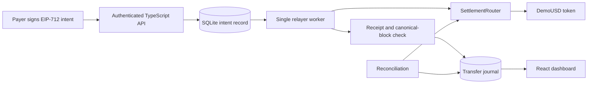
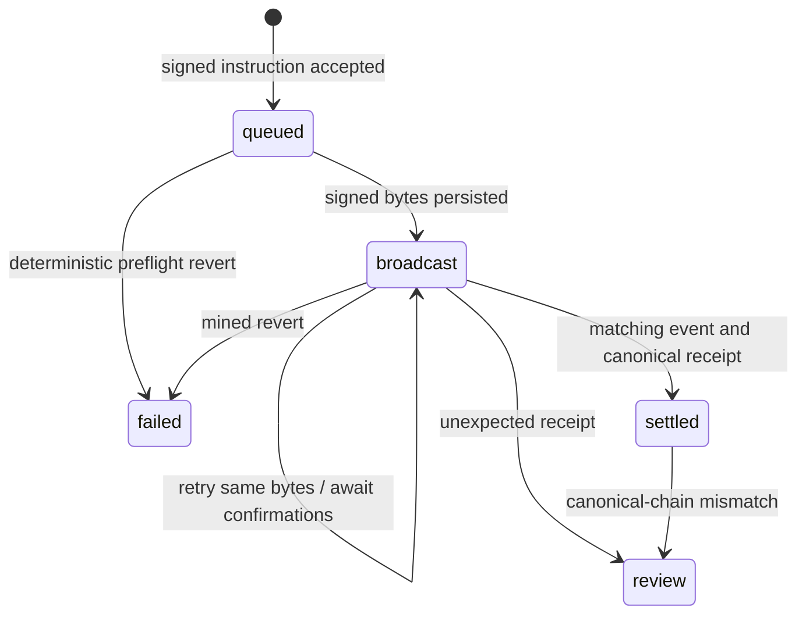

# Architecture

The chain determines token ownership. SQLite is an operational projection, not a separate source of asset balances. A transfer journal row pairs a debit account and credit account with the same positive amount, asset, and transaction provenance. This is a transfer journal rather than a complete general ledger: issuance, fiat deposits, FX valuation, and redemption accounting are outside the implemented model.

## Lifecycle

Signed raw bytes are persisted before sending. After restart, the worker can inspect or retransmit the same transaction hash instead of creating another transfer. Persisted broadcasts are recovered before queued instructions because their signed bytes already reserve a relayer nonce. Within a status group, SQLite insertion order (`rowid`) is used rather than wall-clock timestamps, so clock rollback cannot reorder nonce allocation. An unresolved broadcast blocks subsequent native-nonce allocation.

RPC uncertainty remains pending. A preflight `CALL_EXCEPTION` becomes terminal only when it carries nonempty revert data; missing or empty revert data remains retryable because ethers can use that error code for node or transport failures as well. This is conservative: a genuine empty-data contract revert may need operator investigation.

The worker is serialized within one process. SQLite uses WAL and `synchronous=FULL`; intent/audit, broadcast/audit, failure-status/audit, and journal/finalization/audit writes are transactional. Tests terminate a real worker process at broadcast/finalization boundaries, reopen its file-backed database, and verify recovery without duplicate transfer or journal rows. They also interrupt an uncommitted SQLite transaction and verify rollback. These checks do not establish resilience to arbitrary hardware or filesystem failure.

Store mutations also enforce the lifecycle inside `BEGIN IMMEDIATE`, with an explicit `StateTransitionError` for unknown payments, invalid transitions, or conflicting stored provenance:

| Mutation | Allowed state transition |
| --- | --- |
| Reserve signed broadcast | `queued` → `broadcast` |
| Record failure | `queued` or `broadcast` → `failed` |
| Flag review | `broadcast` or `settled` → `review` |
| Finalize journal | `broadcast` → `settled` |

Repeating an already-broadcast reservation with identical bytes/hash, an identical settled finalization, or an identical terminal status/detail is a no-op with no extra audit entry. Conflicting repetitions and terminal rewrites are rejected. Acceptance's existing-intent lookup now occurs inside the same write transaction as insertion, rather than before it.

Finalization compares every existing journal field against the payment, transaction, and requested block provenance instead of silently ignoring a duplicate insert. A settled retry requires the existing journal and block metadata to agree; a missing or conflicting journal is rejected rather than repaired automatically. These are application invariants over a mutable local database, not tamper-proof storage or on-chain proof. Receipt verification remains the service's responsibility.

There is no distributed lease. Only one process may own a relayer key. A stuck or replaced native transaction may block the queue until an operator investigates it.

RPC mode uses an explicit HTTP timeout (five seconds by default, configurable
through `RPC_TIMEOUT_MS`) with one transport attempt. A silent upstream therefore
releases the current HTTP exchange so the worker can retry from durable state on
a later tick. A timeout never proves that a submitted transaction was rejected.

## Authorization and policy

The EIP-712 domain is ClearLedger version 1 with chain ID and verifying contract. Instructions contain payment ID, payer, payee, token, amount, nonce, and deadline. The contract requires a valid EOA signature, current payer nonce, unused payer-scoped ID, and an unexpired deadline.

Amounts are integer strings in smallest token units at the API boundary and uint256 on chain. Settlement does not use floating-point arithmetic. The dashboard applies six-decimal dUSD formatting only to the explicitly configured local demo asset. RPC assets and other tokens retain exact base-unit strings and their token addresses.

An identical API retry returns its existing record. Different instructions with an existing payer/payment ID produce HTTP 409. Failed instructions remain recorded; a replacement requires a newly authorized ID.

Roles separate issuance, policy, administration, and relaying. The demo assigns administrative roles to one temporary wallet. Router limits are per payer and asset, with UTC days derived from block timestamps. Direct ERC-20 transfers between eligible accounts bypass router spending limits; the limits are not a system-wide compliance guarantee.

Supported assets must be reviewed standard tokens without rebasing or transfer fees. A recipient balance-delta check detects incompatible outcomes but does not make arbitrary malicious tokens safe.

## Finality and projection boundaries

Finalization checks confirmation count, matching event fields, and the receipt's canonical block hash. Reconciliation detects a later mismatch and marks the payment for review; it does not automatically reverse or rebuild journals.

Only payments submitted through this API are journaled. Direct contract calls and ordinary token transfers are not indexed. Overview returns bounded previews of the latest 100 payment records and 100 journal rows. The dashboard uses separate 25-row payment and journal pages, and per-asset totals rather than calculating global volume from overview previews.

Dashboard cursor history belongs to one authentication, network, collection, and payment-filter context. Navigation commits only after a successful response. Superseded requests are aborted and late completions ignored. The newest page can refresh periodically; older pages stay still until navigation or an explicit return to latest. These cursors preserve an insertion range, not a transactional snapshot of changing payment statuses. Journal history has no current payment status field, and is not labelled as currently canonical settlement.

Payment and journal APIs use descending insertion-row-ID keyset pages, default 50 and maximum 100. Their versioned cursors retain collection, status filter, upper insertion boundary, and next position. New inserts above the initial upper boundary do not enter that scan; status changes are not transactionally frozen. Collection/status mismatch and invalid query metadata are rejected.

Reconciliation traverses all settled payment pages, with no fixed 10,000-record cutoff. Each page is materialized before asynchronous RPC requests or status changes. A new run starts a new insertion boundary. This bounds each query result, not the overall reconciliation duration, and is not a transactional snapshot of status membership.

Per-asset totals iterate journal rows using exact BigInt amounts. They report settled and review transfer volume separately, excluding review from settled totals. They do not compute wallet balances, reserves, fiat valuation, or token metadata. A complete on-chain event indexer remains future work.

SQLite keeps the prototype easy to run without an external database. Besu supplies an established consensus implementation; the original work focuses on application correctness and recovery behavior.
